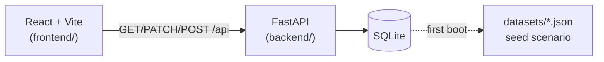

# Paytm Saathi

**From Payments to Progress.**

An AI-powered personal finance companion prototype for students, senior
citizens, first-time digital-payment users and everyday consumers. It helps
people **understand money → plan ahead → stay safer → take action**.

> **Independent demonstration prototype.** All data is simulated. Paytm
> Saathi is not affiliated with, endorsed by or connected to Paytm. It does
> not connect to any bank or wallet, does not process payments, does not
> send SMS/email, and its Safety Center uses simple illustrative rules — not
> a production fraud-detection model. Nothing in this app is financial
> advice.

## What it is

A **full-stack** application: a FastAPI + SQLite backend that owns every
number, and a React + Vite frontend that renders it — and keeps working
offline.



| Piece | Tech | Role |
| --- | --- | --- |
| `frontend/` | React 19, TypeScript, Vite, Tailwind | 8 screens, selectors for all money math, optimistic UI |
| `backend/` | FastAPI, SQLAlchemy 2, Pydantic, SQLite | Authoritative calculations, REST API, idempotent seeding |
| `datasets/` | JSON | Single source of truth for the demo scenario |
| `docs/` | Markdown | Architecture, data dictionary, API, data flow, demo guide |

## Run it

```powershell
# terminal 1 — backend (auto-seeds from datasets/ on first run)
cd backend
.\.venv\Scripts\python -m uvicorn app.main:app --reload --port 8000

# terminal 2 — frontend
cd frontend
npm run dev
```

Open **<http://localhost:5173>** — the header chip shows **API live** and the
dashboard hydrates from `GET /api/overview`. Stop the backend at any point:
the app flips to **Offline · local data** and keeps working from its
LocalStorage cache; **Retry** on the chip re-syncs.

| Command (repo root) | What it does |
| --- | --- |
| `npm run dev` | Frontend dev server (Vite, proxies `/api` → `:8000`) |
| `npm run build` | Type-check + production build of the frontend |
| `npm run lint` | oxlint |
| `npm test` | 45 frontend logic tests (selectors, store, safety, assistant, mappers) |
| `npm run test:backend` | 56 backend tests (API, seeding, formulas, persistence) |
| `npm run start:backend` | Uvicorn with auto-reload |

## Screens

1. **Overview** — balance, month summary, weekly/monthly charts, insight narrative
2. **Transactions** — search, filters, expandable rows, demo flag on the risky payment
3. **Budgets** — per-category limits with live spent/remaining/status
4. **Savings Goals** — targets, contributions, progress
5. **Bills & Reminders** — overdue / upcoming / paid, demo mark-paid
6. **Safety Center** — four transparent risk rules, guided demo alert, scam checklist
7. **AI Assistant** — rule-based answers computed from your live numbers (no cloud AI)
8. **Settings** — Simple Mode, profile, demo data stats, reset

**Simple Mode** (Settings) applies larger type and plainer wording across
every screen.

## Architecture in one paragraph

The server owns the truth: integer paise in SQLite, Pydantic DTOs on the
wire, and the same financial formulas the browser mirrors in its selectors.
Views dispatch optimistic actions; a service layer mirrors each action to
the API and then re-hydrates the state from `/api/overview`, so
server-computed values always win. LocalStorage holds only chat, Simple
Mode and the offline cache. Seeding is non-destructive; a destructive reseed
requires `SAATHI_ALLOW_RESET=1` plus an explicit `POST /api/dev/reseed`.

- [Architecture](docs/ARCHITECTURE.md) · [Data flow](docs/DATA_FLOW.md)
- [Data dictionary](docs/DATA_DICTIONARY.md) · [API reference](docs/API_DOCUMENTATION.md)
- [Professor's demo guide](docs/PROFESSOR_DEMO_GUIDE.md)

## 2-minute live demo

1. **Overview** — point at the cards, then the insight sentence; open DevTools
   Network to show the single `/api/overview` hydration call.
2. **Transactions** — search "zomato"; expand **Neo Tech Store** (flagged).
3. **Budgets** — edit Food ₹6,000 → ₹7,500; watch every dependent number move.
4. **Stop the backend** — chip turns to *Offline · local data*; edit again; **Retry** re-syncs.
5. **Safety Center** — open the high-priority demo alert; four rules, no black box.
6. **Assistant** — "How can I save ₹5,000 this month?" (uses your real remaining budget).
7. **Settings** — Simple Mode toggle, then **Reset demo data** to restore the scenario.

## Deployment (honest limitation)

The **frontend** is a static build (`vercel.json` included) and deploys to
any static host. The **backend** is a long-running Python process with a
SQLite file — it needs a persistent host (a VM, Fly.io, Railway, a college
server). It is **not** deployed to Vercel, because Vercel's Python functions
are stateless and would lose the database; pretending otherwise would break
the demo the first time you edit a budget. Run both locally, or put the
static frontend anywhere and the backend on any Python host, then point
`VITE_DEV_API_TARGET`/your reverse proxy at it.

## Repository layout

```
frontend/     React app (src/, tests/, vite.config.ts with /api proxy)
backend/      FastAPI app (app/, requirements.txt, runtime/ for SQLite)
datasets/     JSON seed files + generator + README
docs/         Architecture, data dictionary, API, data flow, demo guide
```

## Next steps (out of scope for the prototype)

Authentication, a networked database, rate limiting, a real anomaly model,
WCAG audit, internationalisation, and CI. The demo guide lists what to say
if asked about any of these.
