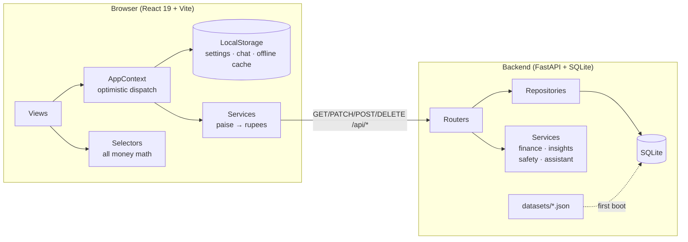
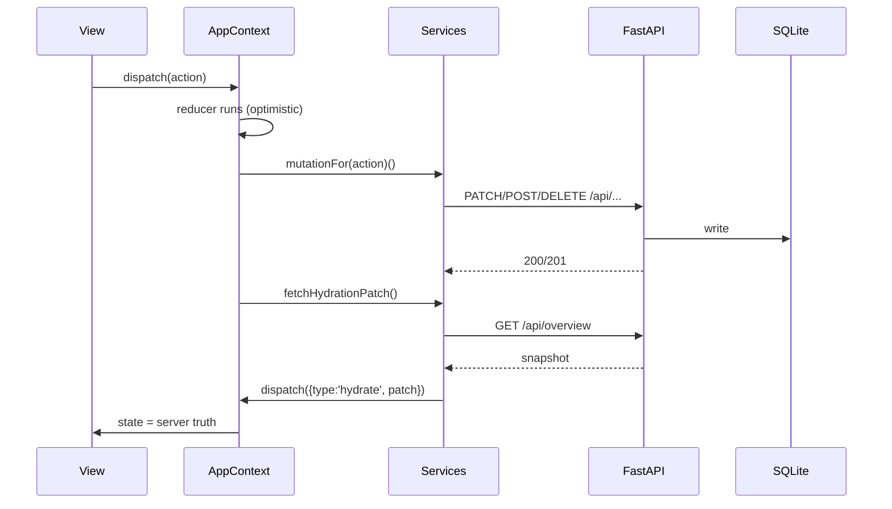

# Architecture

Paytm Saathi is a small full-stack application with one hard rule: **the
server owns every financial number; the browser is a rendering + interaction
layer that keeps working offline.**

## Layers

| Layer | Lives in | Responsibility |
| --- | --- | --- |
| Views | `frontend/src/views` | Presentation only. No money arithmetic. |
| Selectors | `frontend/src/data/selectors.ts` | The single source of truth for every figure shown locally (mirrors backend formulas). |
| State | `frontend/src/data/store.ts` + `state/AppContext.tsx` | Reducer, LocalStorage persistence, optimistic dispatch, API status. |
| Services | `frontend/src/services/` | HTTP calls + the only paise→rupee conversion in the app. |
| API | `backend/app/api/` | REST under `/api`, Pydantic validation, 404/409/422 semantics. |
| Domain | `backend/app/services/` | Balance, budgets, insights, safety scoring, assistant — ports of the frontend logic so both sides always agree. |
| Data | `backend/app/data`, `backend/app/seed.py` | JSON loading, relative-date resolution, idempotent import. |
| Storage | `backend/app/db.py`, `models.py` | SQLite via SQLAlchemy 2.x, foreign keys on. |

## Key decisions

**Server-authoritative, client-optimistic.** Every state-changing view action
runs the local reducer first (instant UI, works offline), then mirrors the
change to the API. On success the context re-hydrates from
`GET /api/overview` so server-computed values (spent-to-date, paid dates,
goal totals) win. See `docs/DATA_FLOW.md`.

**Integer paise on the wire.** The database, DTOs and API speak integer
`*_paise`. Rupees exist only as derived display values; the frontend converts
exactly once, in `services/mappers.ts`.

**Identical algorithms, two runtimes.** Finance, budget status thresholds,
safety rules and assistant intents are implemented once on the server and
mirrored in the frontend. The mirror is what keeps the UI instant and fully
functional when the backend is unreachable; the server copy is what keeps
multiple tabs and a page reload honest.

**Local-only by design:** Simple Mode, chat history and the offline cache of
the last hydration live in LocalStorage. They are never sent to the server.

**Seeding is non-destructive.** Startup imports `datasets/*.json` only when
the `users` table is empty. Resetting requires `SAATHI_ALLOW_RESET=1` and an
explicit `POST /api/dev/reseed`.

## Request lifecycle (happy path)

## Offline path

1. `GET /api/overview` fails with a network error or 5xx → `apiStatus: 'offline'`.
2. The UI keeps the LocalStorage-loaded state (same seed, so numbers match).
3. Mutations still run locally; each attempted API call that fails with a
   network error/5xx keeps the app offline; an HTTP 4xx means the backend is
   alive and simply refused, so the app stays online.
4. The status chip in the header lets the user retry; a successful retry
   re-hydrates and any local divergence is replaced by server truth.

## Security & honesty notes

- No bank, wallet or payment network is contacted anywhere.
- No secrets exist in the frontend; the backend reads configuration from env.
- `/api/dev/reseed` is destructive and disabled by default.
- Safety alerts are four weighted rules over demo data — never a claim of
  confirmed fraud, and the response ships its own disclaimer.
