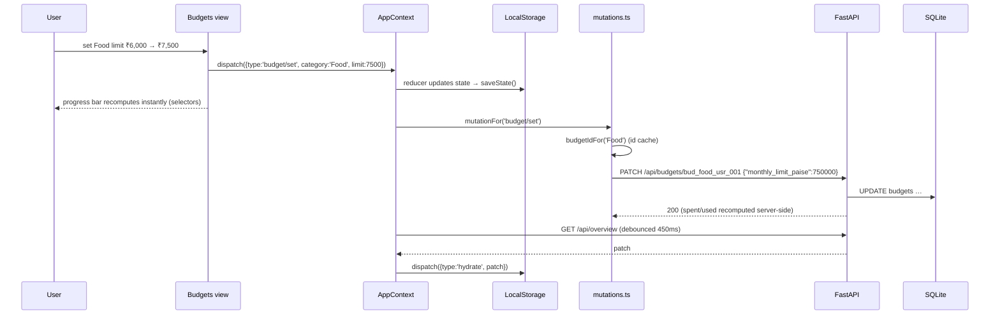

# Data Flow

How a user action travels through the stack, end to end. The invariant that
ties every flow together:

> The local reducer always runs first (the UI never waits). The backend call
> follows. After a successful call the app re-hydrates from
> `GET /api/overview`, so the server's numbers are the ones that stick.

## 1. First load (hydration)

1. `AppProvider` mounts and reads LocalStorage (`paytm-saathi:v1`) — this is
   the instant first paint, and the offline fallback for the whole session.
2. It immediately fires `GET /api/overview?user_id=usr_001`.
3. `services/overviewService.ts` maps the DTO (paise → rupees, ids →
   frontend shapes) into a `hydrate` patch; `store.ts` replaces the
   server-owned slices (profile, openingBalance, transactions, budgets,
   goals, contributions, bills, history) while keeping chat and settings.
4. `apiStatus` becomes `online`. If the call fails with a network error/5xx
   it becomes `offline` and the LocalStorage copy stays on screen; the header
   chip offers a retry.

## 2. Edit a budget (Budgets screen)

Nothing view-side changes: `budgetRows()` in `selectors.ts` re-derives
`spent / remaining / used / status` from transactions + limits on every
render, exactly like `finance.budget_rows()` on the server.

## 3. Contribute to a goal (Goals screen)

`goal/contribute` → reducer increments `goal.saved` and appends a local
contribution (id `c<timestamp>`) → `POST /api/goals/goal_001/contributions
{"amount_paise":250000}` → server updates `saved_amount_paise`, writes an
append-only contribution row, returns both → debounced hydrate replaces the
optimistic contribution with the server's id and timestamp. The available
balance drops by the contribution in both runtimes (same formula).

## 4. Mark a bill paid (Bills screen)

`bill/pay` → reducer sets `status: 'paid'`, `paidDate: now` →
`POST /api/bills/bill_002/mark-paid` → server sets `paid_date` → hydrate.
Undo is `bill/unpay` → `PATCH {"status":"upcoming"}` which also clears
`paid_date` server-side. Splitting into overdue/upcoming/paid happens in
`splitBills()` / `finance.split_bills()` from the due date, so a paid bill
leaves the overdue column the moment either side flips it.

## 5. Assistant question

1. View pushes the user message into local chat (LocalStorage-persisted).
2. `assistantService.askAssistant()` POSTs `/api/assistant/chat`.
3. Backend intent matcher + `services/assistant.py` compute the answer from
   the live database (same numbers as `/api/overview`).
4. Reply is pushed as an assistant message. If the backend is unreachable the
   identical local engine (`assistant/engine.ts`) answers instead — the badge
   shows which engine replied.
5. Nothing about the conversation is stored server-side.

## 6. Safety Center

On mount the view asks `safetyService.fetchSafetyAlerts(state)` →
`GET /api/safety/alerts`. Alerts arrive as ids + scores + triggers; the
mapper joins them onto the frontend transactions it already has (transactions
are read-only in this app, so a fetched list never goes stale). If the call
returns `null`, the local `scoreTransactions()` result — the same four rules,
same weights — renders instead.

## 7. Offline mode

- `apiStatus: 'offline'` shows in the header chip; Settings explains it and
  offers "Retry backend connection".
- Reads: LocalStorage copy (seed-identical at first, diverging only by local
  edits made while offline).
- Writes: applied locally, attempted remotely, failures with network/5xx keep
  the app offline. 4xx means the backend answered — the app stays online and
  simply keeps the local value.
- Chat and safety fall back to the in-browser engines, which need no server.

## 8. Reset / reseed

`resetDemo()` dispatches `reset` (reducer rebuilds seed state, clears chat)
and mirrors it with `POST /api/dev/reseed`. The endpoint is destructive and
403s unless the backend was started with `SAATHI_ALLOW_RESET=1`; a 403 is an
HTTP response, so it never flips the app offline. When the reseed succeeds,
the follow-up hydrate repaints from the freshly imported database.

## Why two copies of the formulas?

The frontend selectors and the backend finance service implement the same
rules (balance, spent-this-month, budget status, median debit, safety
weights, assistant intents). The server copy keeps a reload and multiple
tabs honest; the browser copy is what makes the prototype demoable without a
backend and instant on every keystroke. `tests/` (45 frontend + 56 backend)
pin both copies to the same expected numbers.
